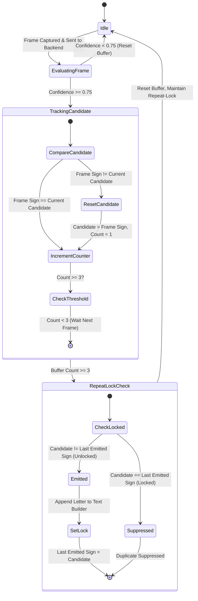
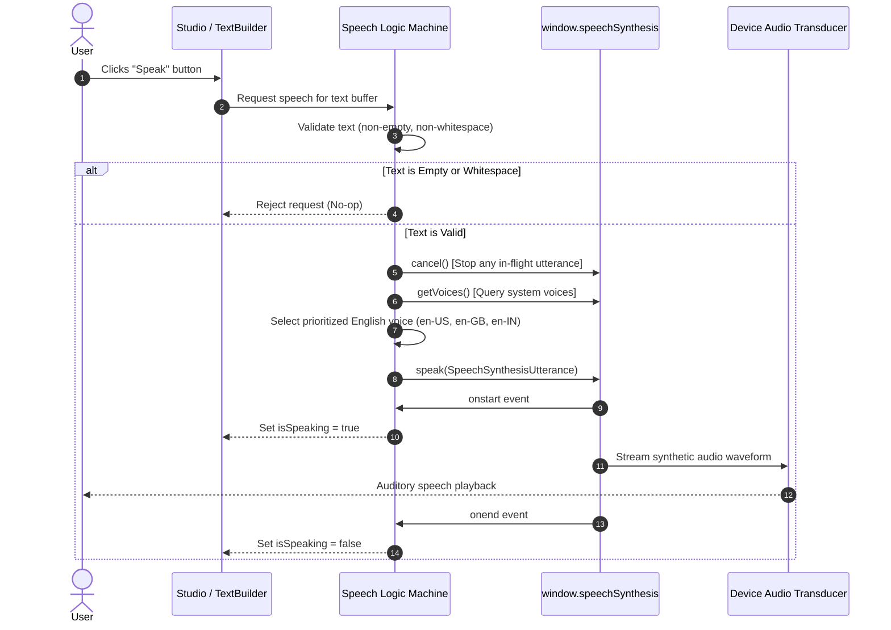
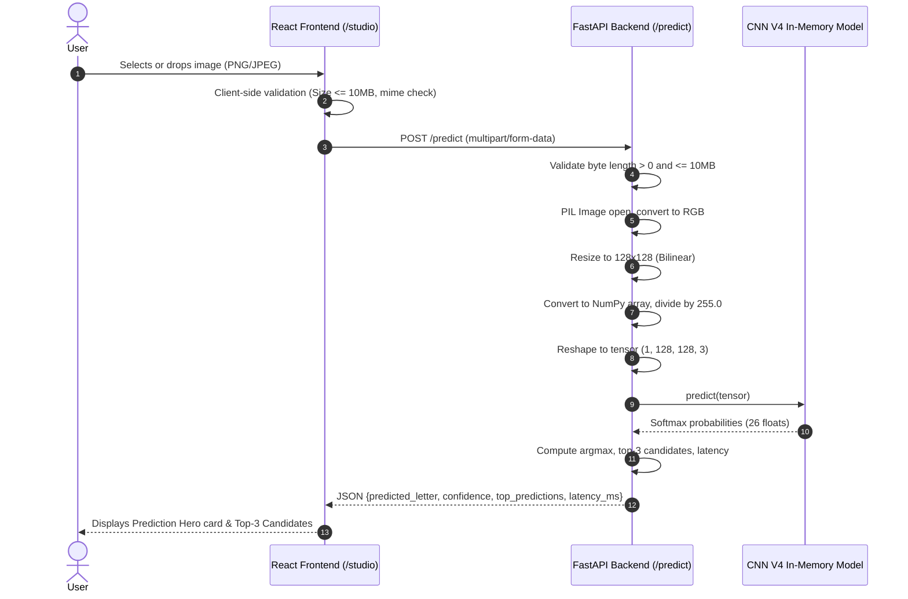
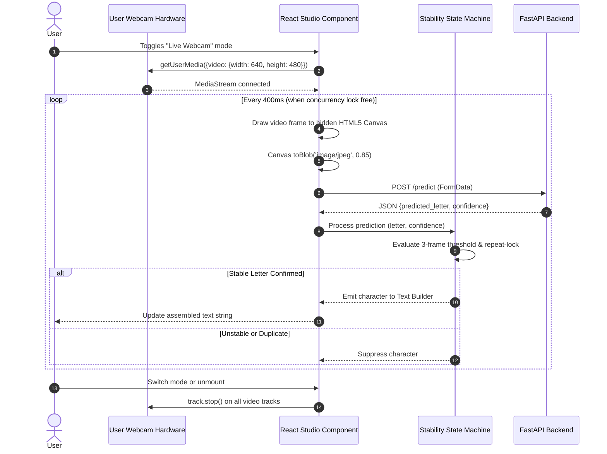

# SignAI System Architecture & Technical Specifications

**Product Name:** SignAI — Indian Sign Language Alphabet Recognition and Voice Conversion Platform  
**Tagline:** Your Hands. Your Voice.  
**Architecture Version:** 2.0 (Post-Phase 7 Redesign & Integration)  
**Target Domain:** Real-time educational accessibility & multimodal assistive technology  

---

## 1. High-Level Architecture Overview

SignAI is built upon a **Three-Tier Decoupled Architecture**, enforcing a strict separation of concerns among the presentation layer, the application programming interface (API), and the deep learning inference engine.

```
┌────────────────────────────────────────────────────────────────────────┐
│                        PRESENTATION LAYER                              │
│              React 19 + Vite 8 + Tailwind CSS 4 + Router               │
│   ┌───────────────┐ ┌────────────────┐ ┌───────────────────────────┐   │
│   │ 6 Route Views │ │ Theme Provider │ │ Real-Time Stability Engine│   │
│   │ (/studio ...) │ │ (Dark / Light) │ │ (3-Frame Buffer, Debounce)│   │
│   └───────┬───────┘ └────────────────┘ └─────────────┬─────────────┘   │
└───────────┼──────────────────────────────────────────┼─────────────────┘
            │ HTTP REST (Multipart Form / JSON)        │ In-Flight Lock
            ▼                                          ▼
┌────────────────────────────────────────────────────────────────────────┐
│                        API & SERVICE LAYER                             │
│                  Python 3.11 + FastAPI + Uvicorn                       │
│   ┌───────────────┐ ┌────────────────┐ ┌───────────────────────────┐   │
│   │ CORS & Guards │ │ Image Decoder  │ │ Lifespan Model Manager    │   │
│   │ (10MB Limit)  │ │ (RGB, 128x128) │ │ (Single-Instance Cache)   │   │
│   └───────────────┘ └───────┬────────┘ └─────────────┬─────────────┘   │
└─────────────────────────────┼────────────────────────┼─────────────────┘
                              │ In-Memory Batch Tensor │
                              ▼ (Shape: 1, 128, 128, 3)│
┌──────────────────────────────────────────────────────┴─────────────────┐
│                     MACHINE LEARNING ENGINE                            │
│                 TensorFlow 2.16 / Keras 3 (CNN V4)                     │
│   ┌────────────────────────────────────────────────────────────────┐   │
│   │ 3 Double-Conv Blocks (32, 64, 128 filters) + BatchNorm + Pool  │   │
│   │ GlobalAveragePooling2D + Dense 128 + L2 Regularization (1e-4)   │   │
│   │ Dense Dropout 0.40 + Softmax 26 Classes (A–Z)                  │   │
│   └────────────────────────────────────────────────────────────────┘   │
└────────────────────────────────────────────────────────────────────────┘
```

### Decoupled Subsystem Responsibilities

1. **Client / Presentation Layer (`frontend/`):**
   - Renders a responsive, modern SaaS web interface across 6 dedicated routes (`/`, `/studio`, `/learn`, `/dashboard`, `/performance`, `/about`).
   - Manages webcam video streams via `navigator.mediaDevices.getUserMedia` with strict resource cleanup (`MediaStreamTrack.stop()`).
   - Houses the client-side gesture stabilization state machine, preventing frame flicker, false transitions, and character flooding.
   - Operates an interactive Text Builder for sentence composition with word-spacing and backspace editing.
   - Synthesizes spoken English using the browser-native Web Speech API (`window.speechSynthesis`).
   - Maintains system-aware theme synchronization (Dark `#0B1220`, Light `#F4F7FC`, System) via `useSyncExternalStore`.

2. **API & Service Layer (`backend/`):**
   - Exposes asynchronous, high-throughput REST endpoints (`/health`, `/predict`, `/`) using FastAPI.
   - Enforces robust request validation: rejection of 0-byte files, non-image formats, and payloads exceeding 10 MB.
   - Preprocesses arbitrary uploaded images into standardized $128 \times 128 \times 3$ RGB tensors normalized to $[0.0, 1.0]$.
   - Manages neural network weights in memory using FastAPI lifespan context management, eliminating per-request loading latency.

3. **Machine Learning Inference Layer (`saved_models/experiments/` & `training/`):**
   - Houses the final selected **CNN V4** checkpoint (`isl_alphabet_cnn_v4_best.keras`).
   - Generates Softmax class probabilities across 26 discrete alphabetical classes ($A$ through $Z$).
   - Returns primary prediction, confidence score, top-3 candidates, and inference execution latency in milliseconds.

---

## 2. Machine Learning Core Specification (CNN V4)

The machine learning core uses the independently evaluated **CNN V4** model, selected after four controlled experiments for its optimal generalization, regularization balance, and operational stability.

### 2.1 Model Architecture

| Layer Type | Specification | Output Dimension | Regularization / Activation |
|---|---|---|---|
| **Input** | Standardized RGB Hand Sign | `(None, 128, 128, 3)` | Normalized to $[0.0, 1.0]$ |
| **Conv Block 1A** | Conv2D (32 filters, $3 \times 3$, padding='same') | `(None, 128, 128, 32)` | ReLU, L2 ($\lambda = 0.0001$) |
| **BatchNorm 1A** | BatchNormalization | `(None, 128, 128, 32)` | Scale & Center |
| **Conv Block 1B** | Conv2D (32 filters, $3 \times 3$, padding='same') | `(None, 128, 128, 32)` | ReLU, L2 ($\lambda = 0.0001$) |
| **BatchNorm 1B** | BatchNormalization | `(None, 128, 128, 32)` | Scale & Center |
| **Pool 1** | MaxPooling2D ($2 \times 2$) | `(None, 64, 64, 32)` | Spatial Downsampling |
| **Conv Block 2A** | Conv2D (64 filters, $3 \times 3$, padding='same') | `(None, 64, 64, 64)` | ReLU, L2 ($\lambda = 0.0001$) |
| **BatchNorm 2A** | BatchNormalization | `(None, 64, 64, 64)` | Scale & Center |
| **Conv Block 2B** | Conv2D (64 filters, $3 \times 3$, padding='same') | `(None, 64, 64, 64)` | ReLU, L2 ($\lambda = 0.0001$) |
| **BatchNorm 2B** | BatchNormalization | `(None, 64, 64, 64)` | Scale & Center |
| **Pool 2** | MaxPooling2D ($2 \times 2$) | `(None, 32, 32, 64)` | Spatial Downsampling |
| **Conv Block 3A** | Conv2D (128 filters, $3 \times 3$, padding='same') | `(None, 32, 32, 128)` | ReLU, L2 ($\lambda = 0.0001$) |
| **BatchNorm 3A** | BatchNormalization | `(None, 32, 32, 128)` | Scale & Center |
| **Conv Block 3B** | Conv2D (128 filters, $3 \times 3$, padding='same') | `(None, 32, 32, 128)` | ReLU, L2 ($\lambda = 0.0001$) |
| **BatchNorm 3B** | BatchNormalization | `(None, 32, 32, 128)` | Scale & Center |
| **Pool 3** | MaxPooling2D ($2 \times 2$) | `(None, 16, 16, 128)` | Spatial Downsampling |
| **GAP** | GlobalAveragePooling2D | `(None, 128)` | Spatial Feature Aggregation |
| **Dense** | Dense (128 units) | `(None, 128)` | ReLU, L2 ($\lambda = 0.0001$) |
| **Dropout** | Dropout (rate = 0.40) | `(None, 128)` | Feature Co-adaptation Prevention |
| **Output** | Dense (26 units) | `(None, 26)` | Softmax Probability Distribution |

### 2.2 Parameter Breakdown
- **Trainable Parameters:** 307,322
- **Non-Trainable Parameters (BatchNorm):** 896
- **Total Parameters:** 308,218
- **Checkpoint File:** `saved_models/experiments/isl_alphabet_cnn_v4_best.keras` (3,806,482 bytes)
- **Loss Function:** Categorical Cross-Entropy with L2 Kernel Penalty:
  $$\mathcal{L} = -\sum_{i=1}^{26} y_i \log(\hat{y}_i) + \lambda \sum_{w \in \mathcal{W}} \|w\|_2^2$$
  where $\lambda = 1.0 \times 10^{-4}$.

### 2.3 Independent Test Evaluation Metrics
Evaluated on 5,161 strictly held-out test images (`dataset/processed/Testing/`):
- **Test Accuracy:** **86.34%** (4,456 / 5,161 correct; +27.30 percentage points over baseline)
- **Macro F1 Score:** **83.96%** (+27.22 percentage points over baseline)
- **Weighted F1 Score:** **83.87%**
- **Macro Precision:** **85.22%**
- **Macro Recall:** **86.42%**
- **Exemplary Classes (100% Precision & Recall):** D, H, L, R
- **High-Performing Classes (>90% F1):** B, G, J, K, M, O, P

---

## 3. Real-Time Gesture Stabilization State Machine

In real-time webcam operation (10–30 FPS), raw frame-by-frame inference suffers from:
1. **Transition Noise:** Rapid flickering during hand repositioning.
2. **Duplicate Character Flooding:** A held gesture generating 20+ identical letters per second.

SignAI resolves these challenges through a deterministic **3-Stage Client-Side Stabilization Filter**.



### Algorithmic Parameters
- **Confidence Threshold ($\tau$):** 0.75 ($75\%$). Frames below $\tau$ immediately clear the candidate buffer.
- **Consecutive Frame Count ($N$):** 3 consecutive matching predictions required before gesture confirmation.
- **Inference Interval:** $400\text{ ms}$ polling cycle ($2.5\text{ inferences/sec}$), balancing real-time responsiveness with CPU efficiency.
- **Concurrency Guard:** An in-flight request lock drops subsequent frame dispatches until the active HTTP request completes, preventing request queue buildup and latency drift.
- **Repeat-Lock:** Once a stable letter is emitted to the Text Builder, further emissions of that same letter are suppressed until a different gesture is recognized or the hand is lowered.

---

## 4. Voice Conversion Engine Architecture

The voice conversion subsystem bridges recognized fingerspelled text to auditory speech using the browser-native **Web Speech API** (`window.speechSynthesis`).



### Voice Priority Strategy
To ensure intelligible English vocalization across operating systems (Windows, macOS, Linux, Android):
1. **Primary Candidates:** Voices explicitly tagged `en-US`, `en-GB`, or `en-IN`.
2. **Platform Native Voices:** Prioritizes high-naturalness voices (e.g., Microsoft David/Zira, Google US English, Apple Samantha).
3. **Graceful Fallback:** Defaults to the system primary voice if specific English locales are absent.

---

## 5. End-to-End System Workflows

### 5.1 Static Image Upload Inference Pipeline



### 5.2 Real-Time Webcam Streaming Pipeline



---

## 6. Frontend Route & Component Hierarchy

```
frontend/src/
├── App.jsx                     # Router, theme wrapper, navigation bar, footer
├── index.css                   # Tailwind CSS 4 theme variables and design tokens
├── context/
│   ├── ThemeContext.jsx        # ThemeProvider component
│   └── themeContextInstance.js # Context instance definition
├── hooks/
│   └── useTheme.js             # Theme consumer hook
├── pages/
│   ├── Home.jsx                # / landing page: hero, features, pipeline card
│   ├── Studio.jsx              # /studio: upload, webcam reticle, prediction hero, text builder
│   ├── Learn.jsx               # /learn: 26 ISL alphabet cards with verified photos & modal
│   ├── Dashboard.jsx           # /dashboard: 4 KPI metric cards, live /health monitor
│   ├── Performance.jsx         # /performance: experiment table V1–V5, per-class metrics, artifacts
│   └── About.jsx               # /about: mission, team, 3-tier architecture, UN SDG 10
├── components/
│   ├── Header.jsx              # Responsive navigation, route indicators, theme toggle
│   ├── Footer.jsx              # Product identity, quick links, system status indicator
│   ├── UploadCard.jsx          # Drag-and-drop file upload zone with file preview
│   ├── WebcamReticle.jsx       # Camera viewport with reticle overlay and FPS/status tags
│   ├── PredictionHero.jsx      # Top prediction card, confidence gauge, top-3 candidates
│   ├── TextBuilder.jsx         # Sentence workspace, word count, backspace, space, clear
│   └── SpeechControls.jsx      # Speak / Stop buttons, voice selector, playback indicator
├── services/
│   └── api.js                  # Axios/Fetch client for /health and /predict endpoints
├── utils/
│   ├── textBuilderLogic.js     # Pure functions for string manipulation and text metrics
│   └── speechLogic.js          # Pure functions for speech state transitions & voice filtering
└── tests/                      # 5 test suites (57 tests)
```

---

## 7. Known Architectural Boundaries & Limitations

1. **Static 2D CNN vs Dynamic Motion Strokes (J & Z):**
   - Natural ISL fingerspelling for **'J'** involves tracing a curved downward hook, while **'Z'** involves tracing a zigzag stroke.
   - A static 2D CNN processes single frames and cannot represent temporal trajectory. In SignAI, static keyframes represent these signs, achieving 93.9% F1 on J and 66.7% F1 on Z. Full temporal sign recognition requires 3D-CNN or sequence modeling architectures (e.g., CNN-LSTM or Transformers) planned for future work.
2. **Planar Silhouette Ambiguity (W vs E/I/X):**
   - In 2D projection, the three extended fingers of 'W' can experience planar overlap under certain angles. Multi-view camera systems or 3D coordinate estimation (e.g., MediaPipe Hands) represent the logical next enhancement.
3. **Lighting & Background Robustness:**
   - CNN V4 was trained with photometric augmentations (brightness, contrast, hue, saturation) to improve generalization across varying lighting conditions. However, extreme underexposure or complex skin-tone-matching backgrounds may degrade confidence scores below the 0.75 threshold.
